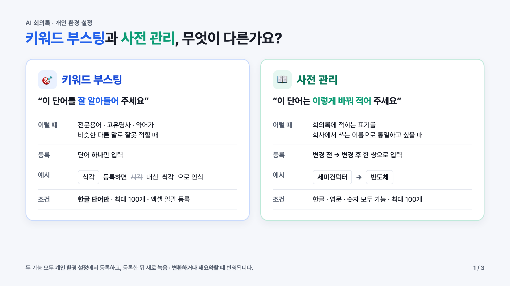
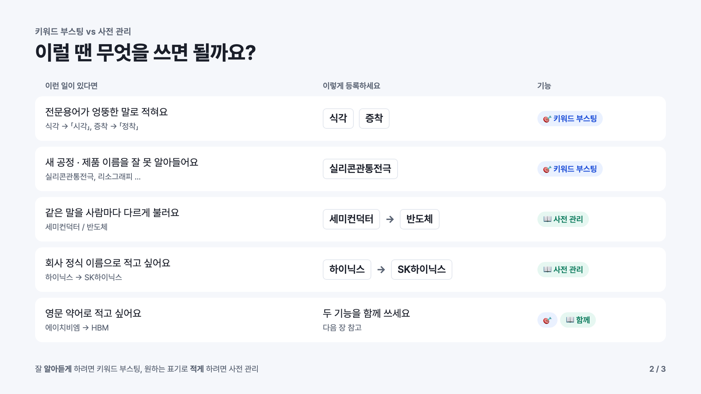
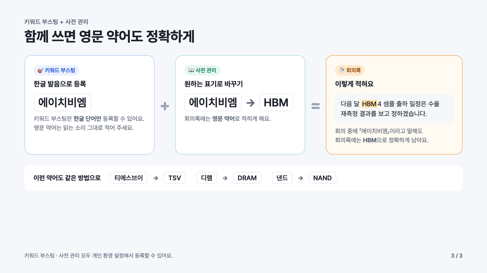

# 키워드 부스팅과 사전 관리, 무엇이 다른가요?

> AI 회의록 · 개인 환경 설정
> 두 기능 모두 **개인 환경 설정**에서 등록하고, 등록한 뒤 **새로 녹음 · 변환하거나 재요약할 때** 반영됩니다.

## 1. 한눈에 비교

| | 🎯 키워드 부스팅 | 📖 사전 관리 |
|---|---|---|
| 한마디로 | “이 단어를 **잘 알아들어** 주세요” | “이 단어는 **이렇게 바꿔 적어** 주세요” |
| 이럴 때 | 전문용어 · 고유명사 · 약어가 비슷한 다른 말로 잘못 적힐 때 | 회의록에 적히는 표기를 회사에서 쓰는 이름으로 통일하고 싶을 때 |
| 등록 | 단어 **하나**만 입력 | **변경 전 → 변경 후** 한 쌍으로 입력 |
| 예시 | `식각` 등록하면 ~~시각~~ 대신 **식각**으로 인식 | `세미컨덕터` → `반도체` |
| 조건 | **한글 단어만** · 최대 100개 · 엑셀 일괄 등록 | 한글 · 영문 · 숫자 모두 가능 · 최대 100개 |

---

## 2. 이럴 땐 무엇을 쓰면 될까요?

| 이런 일이 있다면 | 이렇게 등록하세요 | 기능 |
|---|---|---|
| 전문용어가 엉뚱한 말로 적혀요 (식각 → 「시각」, 증착 → 「정착」) | `식각` `증착` | 🎯 키워드 부스팅 |
| 새 공정 · 제품 이름을 잘 못 알아들어요 (실리콘관통전극, 리소그래피 …) | `실리콘관통전극` | 🎯 키워드 부스팅 |
| 같은 말을 사람마다 다르게 불러요 (세미컨덕터 / 반도체) | `세미컨덕터` → `반도체` | 📖 사전 관리 |
| 회사 정식 이름으로 적고 싶어요 (하이닉스 → SK하이닉스) | `하이닉스` → `SK하이닉스` | 📖 사전 관리 |
| 영문 약어로 적고 싶어요 (에이치비엠 → HBM) | 두 기능을 함께 쓰세요 (3번 참고) | 🎯 + 📖 함께 |

**잘 알아듣게** 하려면 키워드 부스팅, 원하는 표기로 **적게** 하려면 사전 관리.

---

## 3. 함께 쓰면 영문 약어도 정확하게

| 🎯 키워드 부스팅 | | 📖 사전 관리 | | 📄 회의록 |
|---|---|---|---|---|
| `에이치비엠` 등록 | **+** | `에이치비엠` → `HBM` 등록 | **=** | 「다음 달 **HBM**4 샘플 출하 일정은 수율 재측정 결과를 보고 정하겠습니다.」 |
| 키워드 부스팅은 **한글 단어만** 등록할 수 있어요. 영문 약어는 읽는 소리 그대로 적어 주세요. | | 회의록에는 **영문 약어**로 적히게 해요. | | 회의 중에 「에이치비엠」이라고 말해도 회의록에는 **HBM**으로 정확하게 남아요. |

이런 약어도 같은 방법으로 등록할 수 있어요.

- `티에스브이` → `TSV`
- `디램` → `DRAM`
- `낸드` → `NAND`

---

### 함께 보면 좋은 매뉴얼

- `31_keyword-boosting.gif` — 키워드 부스팅 하나씩 등록 · 삭제
- `32_keyword-boosting-bulk.gif` — 키워드 부스팅 엑셀 일괄 등록
- `17_dictionary.gif` — 사전 관리 등록
