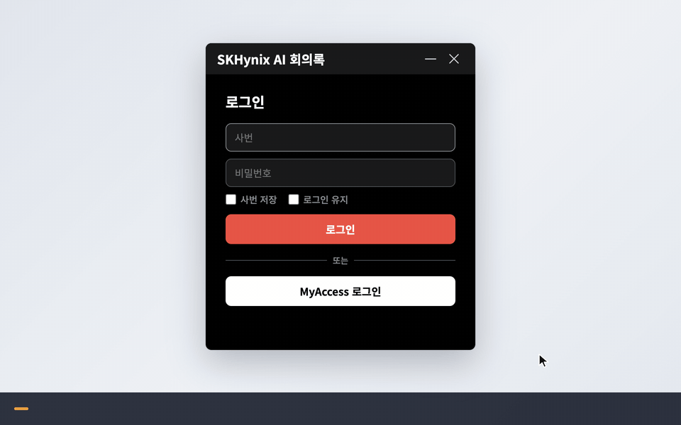
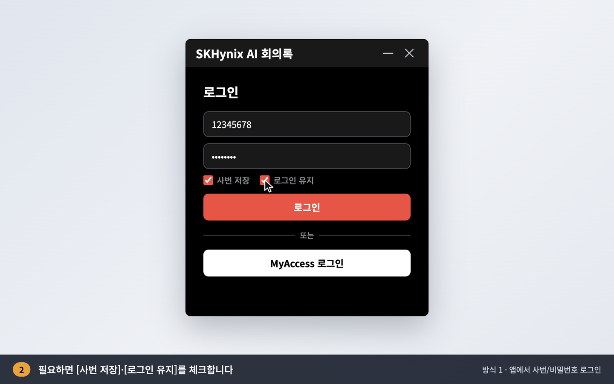
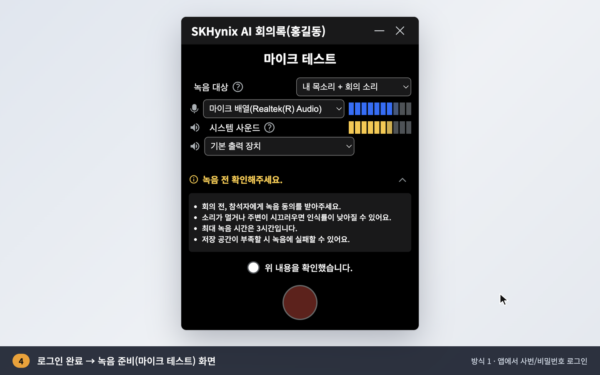
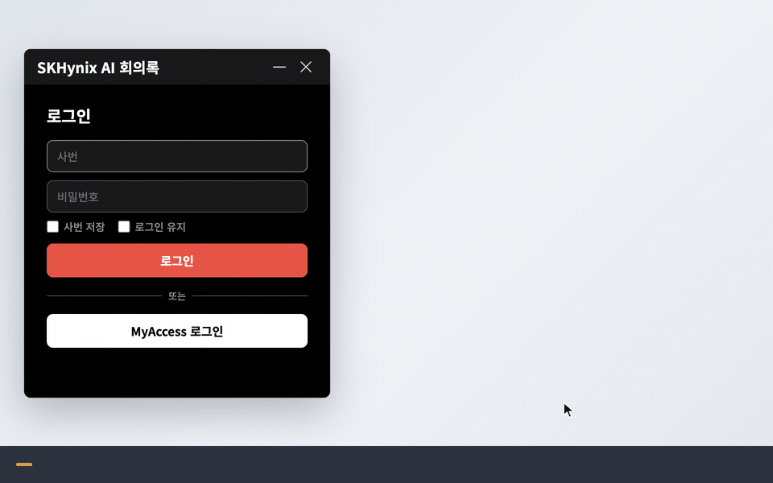
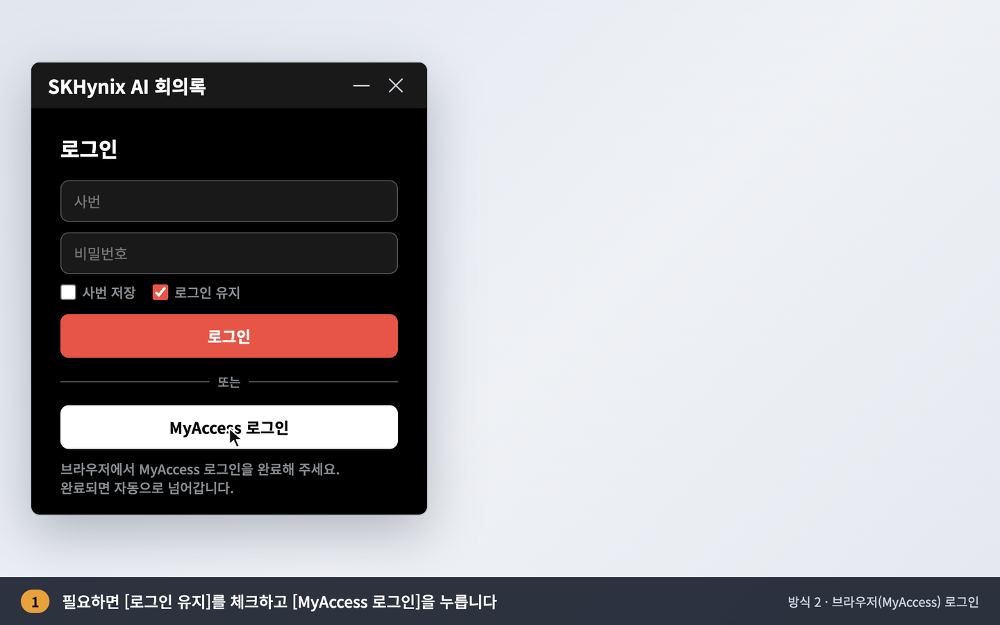
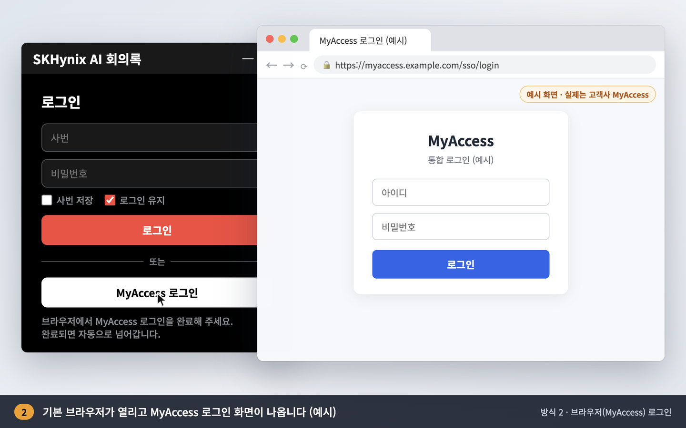
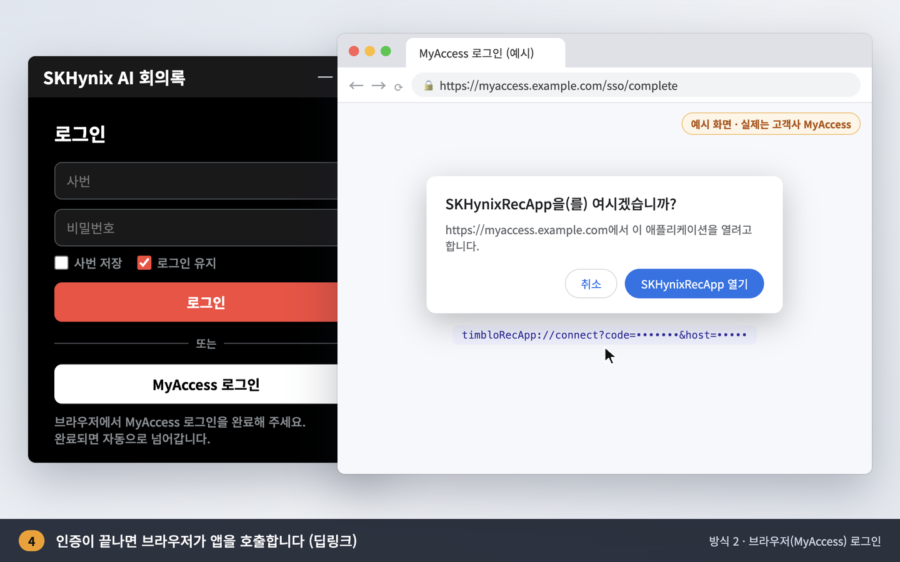

# PC 녹음 앱 로그인 방식 안내 및 MyAccess 연동 자료 요청

PC 녹음 앱(SKHynix AI 회의록)에서 지금 지원하는 로그인 방식은 아래 두 가지입니다.
MyAccess에서 어떤 방식을 지원하는지 확인 부탁드리고, 지원하는 방식의 **연동 문서**를 공유해 주시면 그에 맞춰 적용하겠습니다.

> 화면 속 사번·이름·계정은 예시 값입니다. 방식 2의 브라우저 화면은 흐름을 보여주기 위한 **예시 화면**이며, 실제로는 MyAccess 로그인 화면이 열립니다.

---

## 방식 1. 앱에서 사번/비밀번호로 로그인 (API 인증)

1. 앱 로그인 화면에서 **사번·비밀번호**를 입력합니다.
2. 필요하면 **[사번 저장]**, **[로그인 유지]**를 체크합니다.
3. **[로그인]**을 누르면 앱이 로그인 API로 인증합니다.
4. 인증이 끝나면 녹음 준비(마이크 테스트) 화면으로 넘어갑니다.

| 입력 | 로그인 완료 |
|---|---|
|  |  |

## 방식 2. 브라우저에서 MyAccess로 로그인 (OAuth 방식)

1. 앱에서 **[MyAccess 로그인]**을 누릅니다. 로그인 유지는 이 방식에도 적용됩니다.
2. PC 기본 브라우저가 열리고 **MyAccess 로그인 화면**이 나옵니다.
3. 브라우저에서 MyAccess 계정으로 로그인합니다.
4. 인증이 끝나면 브라우저가 앱을 호출합니다(딥링크 `timbloRecApp://connect?code=…`).
5. 앱이 받은 인증 코드를 토큰으로 바꿔 로그인을 마치고, 녹음 준비 화면으로 넘어갑니다.

| 앱에서 시작 | 브라우저 로그인 (예시) | 앱 호출 (딥링크) |
|---|---|---|
|  |  |  |

---

## 요청 사항

1. **지원 방식 확인**: MyAccess에서 위 두 방식 중 무엇을 지원하는지 알려주세요.
   - 방식 1: 사번/비밀번호를 받아 인증하는 API
   - 방식 2: 브라우저 로그인 후 앱으로 돌려보내기(리다이렉트/딥링크)
2. **그 밖의 방식**: 사내 메신저처럼 PC에 로그인된 정보(윈도우 로그인, SSO 에이전트 등)로 **입력 없이 자동 로그인**하는 방식이 있다면 함께 알려주세요.
3. **연동 문서**: 지원하는 방식의 연동 가이드를 공유해 주세요.
   - 인증 요청·응답 형식(URL, 파라미터, 토큰/사용자 정보 항목)
   - 앱 등록에 필요한 정보(Client ID, 리다이렉트 URI 등)
   - 테스트 환경과 테스트 계정
