# AI 회의록 녹음 기능 안내서

> 녹음 버튼을 누르는 순간부터 회의록이 만들어질 때까지의 전체 과정과 상황별 대처 방법을 안내합니다.
>
> 완성된 회의록은 **PC에서 AI회의록 시스템(https://aimeeting.skhynix.com/)** 에 접속해 확인합니다. 모바일 앱에서는 녹음과 업로드를 하고, 완료 알림을 받습니다.

---

## 1. 녹음 방식 소개

| 구분 | 단독 녹음 | 그룹 녹음 |
|---|---|---|
| 이런 경우에 사용하세요 | 휴대폰 1대로 회의를 녹음할 때 | 넓은 회의실 등에서 여러 대의 휴대폰을 자리마다 두고 함께 녹음할 때 |
| 참여 기기 | 1대 | 최대 5대 (진행자 포함) |
| 녹음 조작 | 본인이 직접 | 진행자(방장)가 시작, 일시정지, 종료를 모두 제어 |
| 최대 녹음 시간 | 3시간 | 1시간 |
| 결과 | 내 회의록 1건 | 모든 기기의 음성을 하나로 합친 회의록이 참여자 **각자의 회의록**으로 생성 |
| 회의록 확인 | PC 웹 (AI회의록 시스템) | PC 웹 (AI회의록 시스템) |

### 녹음 메뉴 찾기

홈 화면 가운데의 **[녹음] 버튼**을 누르면 녹음 방식을 고르는 메뉴가 열립니다.

- **녹음**: 단독 녹음을 시작합니다.
- **그룹 녹음**: 그룹을 만들거나 다른 사람의 그룹에 참여합니다.

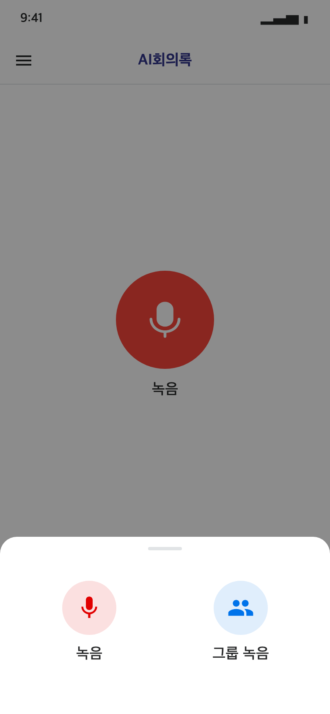

---

## 2. 녹음 전체 과정 (단독 녹음 기준)

```
STEP 1 녹음 시작        (관리자 메일 발송 확인 → [확인])
   ↓
STEP 2 녹음 중  ── 일시정지/재개 · 전화 · 알림/긴급문자 · 화면 꺼짐
   ↓
STEP 3 [종료] → 녹음 완료 설정 (참석자 수 · 언어 · 템플릿 · 제목) → [확인]
   ↓                                   ※ 이 시점부터 바로 새 녹음 가능
STEP 4 파일 업로드      (홈 하단 패널: 진행률 · 전송 속도 · 남은 시간)
   ↓
STEP 5 녹음 파일 변환   (홈 하단 패널: 음성 인식 → 요약)
   ↓
STEP 6 회의록 완성      (알림함 알림 → PC 웹에서 회의록 확인)
```

### STEP 1. 녹음 시작

1. 홈의 [녹음] 버튼 → **녹음**을 누르면 녹음 화면이 열립니다.
2. 가운데 **녹음 버튼**을 누르면 **"녹음을 시작할까요?"** 확인 창이 나타납니다.
   > 녹음 시작시 관리자에게 메일이 발송됩니다.
   > 회의 시작 전, 참석자에게 녹음 동의를 받아주세요.
3. **[확인]** 을 누르면 관리자에게 메일이 발송되고("관리자에게 메일이 발송되었습니다.") 녹음이 시작됩니다. 화면에 경과 시간과 음성 파형이 표시됩니다.

> - 녹음 화면에 들어가기만 해서는 녹음이 시작되지 않습니다. 반드시 녹음 버튼을 누르고 확인 창에서 [확인]을 눌러 주세요.
> - 메일 발송에 실패하면 "이메일 발송에 실패하였습니다." 안내가 나타나고 **녹음이 시작되지 않습니다.** 네트워크 연결을 확인한 뒤 다시 시도해 주세요.

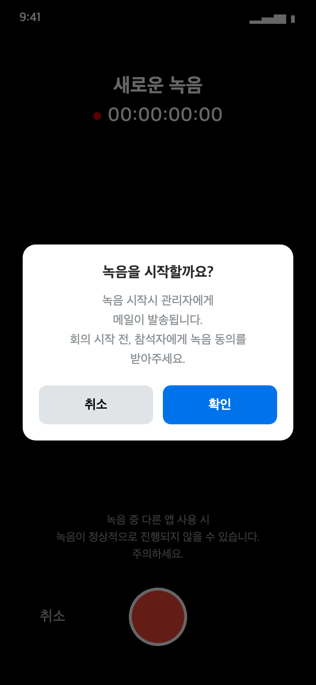

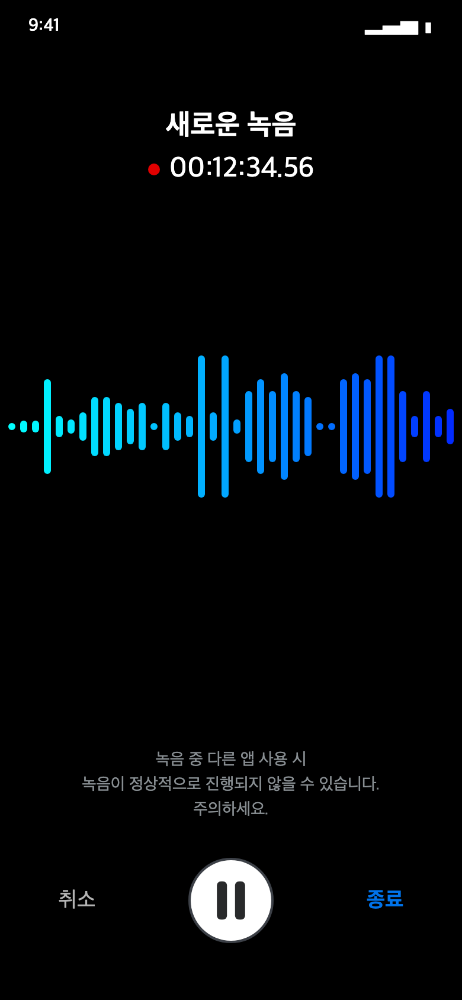

### STEP 2. 녹음 중

| 상황 | 앱 동작 | 사용자 조치 |
|---|---|---|
| **일시정지** | 녹음 버튼을 누르면 "녹음이 일시정지 되었습니다." 안내와 함께 녹음이 멈춥니다. | 다시 누르면 이어서 녹음됩니다. |
| **전화 수신** | "통화로 인해 녹음이 일시정지 되었습니다."와 함께 자동으로 일시정지됩니다. | 통화가 끝나거나 거절하면 **자동으로 다시 녹음**됩니다. ("통화가 종료되어 녹음을 재개했습니다.") ※ 기종에 따라 자동으로 재개되지 않으면 녹음 버튼을 눌러 재개하세요. |
| **통화 중 녹음 시작/재개** | "녹음할 수 없습니다" 안내가 나타납니다. | 통화를 마친 뒤 녹음 버튼을 누르세요. |
| **알림음, 알람, 긴급재난문자** | 소리가 나는 알림이 오면 녹음이 잠시 멈출 수 있습니다. iPhone은 알림이 끝나면 **자동으로 다시 녹음**됩니다. ※ 휴대폰 기종과 OS 버전에 따라 동작이 다를 수 있습니다. | 알림 뒤에는 화면에서 경과 시간이 계속 흐르는지 확인하고, 멈춰 있으면 녹음 버튼을 눌러 재개하세요. |
| **뒤로 가기** | 녹음이 취소되지 않고 **일시정지**됩니다. | - |
| **다른 앱으로 이동 / 화면 끔** | 녹음이 계속됩니다. 녹음 중에는 화면이 자동으로 꺼지지 않습니다. | 다른 앱이 마이크를 쓰면 녹음이 정상적으로 되지 않을 수 있으니 주의하세요. |
| **최대 3시간 도달** | 녹음이 자동으로 멈추고 STEP 3의 설정 창이 열립니다. | 설정을 확인하고 [확인]을 누르세요. |
| **저장공간 95% 초과** | 녹음이 자동으로 중지되고 "디스크 용량이 95%를 초과하여 녹음이 중지되었습니다." 안내가 나타납니다. | 휴대폰 저장공간을 확보하세요. |
| **[취소]** | 확인하면 지금까지의 녹음이 **저장되지 않고 삭제**됩니다. | 삭제한 녹음은 복구할 수 없습니다. |

### STEP 3. 녹음 종료와 완료 설정

오른쪽 아래 **[종료]** 를 누르면 녹음이 잠시 멈추고 **녹음 완료 설정** 창이 열립니다.

| 항목 | 설명 |
|---|---|
| 참석자 수 (회의 규모) | 1~2명 / 3~6명 / 7~10명 / 11명 이상. 실제로 발언한 사람 수를 기준으로 고르면 인식 정확도가 높아집니다. |
| 인식 언어 | 한국어(기본), 영어, 일본어, 중국어 |
| 요약 템플릿 | 회의록 요약 형식을 고릅니다. |
| 회의록 제목 | 회의록 제목을 입력합니다. |

**[확인]** 을 누르면 녹음 화면이 닫히고 **바로 홈 화면으로 이동**하면서 업로드가 자동으로 시작됩니다.

> ✅ **업로드가 끝날 때까지 기다리지 않아도 됩니다.** 홈에서 바로 새 녹음을 시작해도 되고, 앞선 녹음은 순서대로 자동 업로드됩니다.

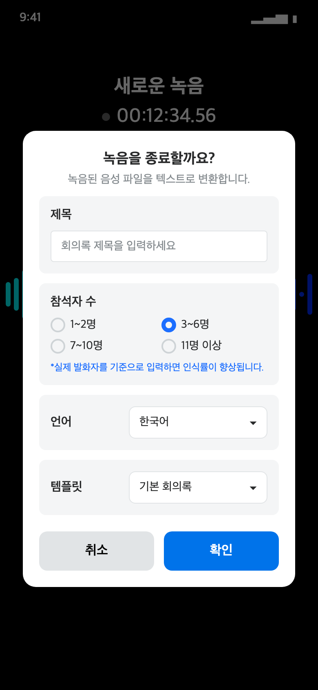

### STEP 4. 파일 업로드

홈 화면 하단에 **"파일 업로드 N건 진행 중"** 패널이 나타납니다.

| 표시 항목 | 내용 |
|---|---|
| 파일명 | 업로드 중인 녹음 파일 |
| 진행률 | 진행 막대와 % |
| 전송 속도 / 남은 시간 | 현재 업로드 속도와 예상 남은 시간 |
| 안내 문구 | "업로드가 완료될 때까지 기다려주세요." |
| 주의 문구 (빨간색) | "* 파일 업로드 중 화면을 닫거나 앱을 종료하면 업로드가 중단될 수 있습니다. 회의 결과는 웹에서 확인 부탁드립니다." |

- 패널 제목을 누르면 **접거나 펼칠** 수 있습니다.
- 녹음이 여러 건이면 **들어온 순서대로 한 건씩** 업로드됩니다.
- 업로드 중에 다른 화면으로 가거나 앱을 백그라운드로 보내도 업로드가 계속됩니다.
- 단, 업로드 중에 **앱을 완전히 종료하면 업로드가 중단될 수 있습니다.** 업로드가 끝날 때까지 앱을 종료하지 마세요.

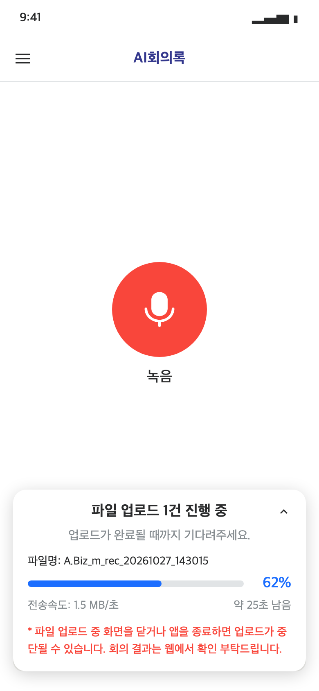

### STEP 5. 녹음 파일 변환

업로드가 끝나면 패널이 **"녹음 파일 변환 N건 진행 중"** 으로 바뀌고, 서버에서 회의록을 만드는 과정을 보여 줍니다.

| 단계 | 패널 표시 |
|---|---|
| 음성 인식 | "음성 인식 중..." + 진행률 |
| 요약 | "요약 진행 중..." |
| 요약 완료 | "요약 진행 완료" |

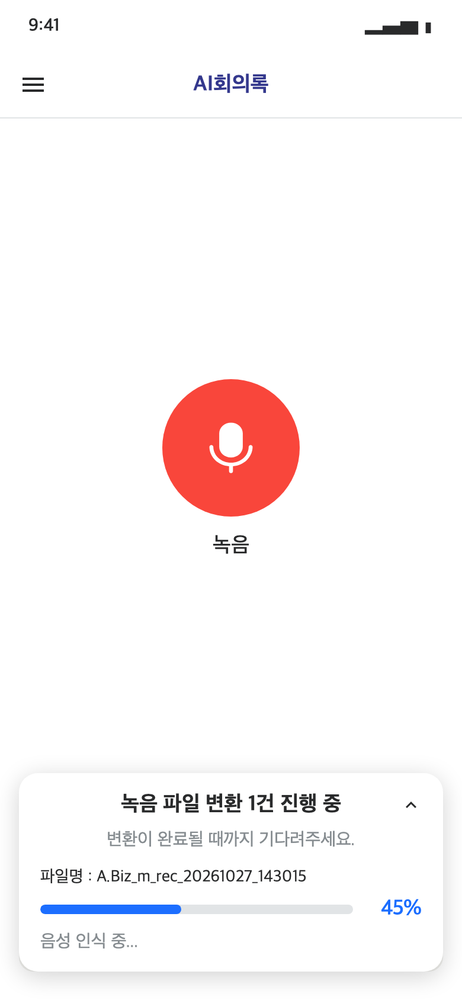

### STEP 6. 회의록 완성

변환이 끝나면 패널이 사라지고, 앱의 **알림함**에 "회의록이 생성되었습니다." 알림이 표시됩니다.
완성된 회의록은 **PC에서 AI회의록 시스템(https://aimeeting.skhynix.com/)** 에 접속해 확인하세요.

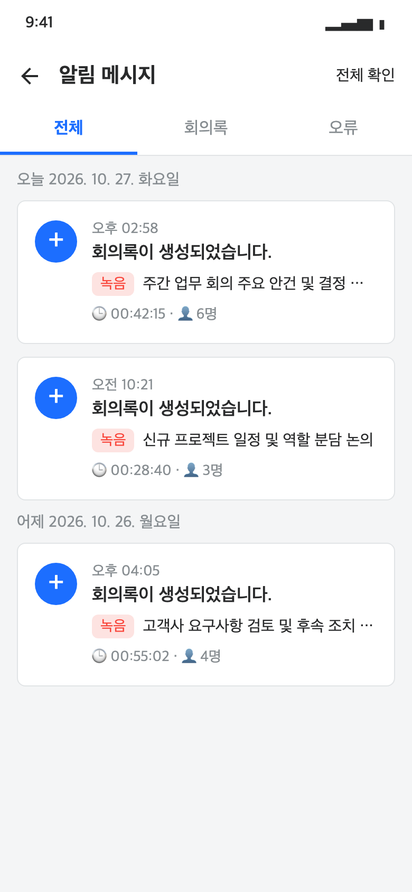

---

## 3. 그룹 녹음

여러 대의 휴대폰이 **동시에** 녹음하고, 서버에서 모든 음성을 하나로 합쳐 회의록을 만듭니다.
그룹을 만든 사람이 **진행자(방장)**, 코드를 입력해 들어온 사람이 **참여자**가 됩니다.

### 3-1. 진행자와 참여자 기능 비교

| 기능 | 진행자 (방장) | 참여자 |
|---|---|---|
| 그룹 만들기 | ✅ 4자리 그룹 코드 발급 | - |
| 그룹 참여 | - | ✅ 그룹 코드 입력 |
| 그룹 코드 확인·복사 | ✅ | ✅ |
| 참여 인원 확인 | ✅ | ✅ |
| 녹음 시작 | ✅ **[녹음 시작]** 버튼 → 관리자 메일 발송 확인 → [확인] | ❌ 진행자가 시작하면 **자동 시작** |
| 관리자 메일 발송 | 녹음 시작 전 확인 창에서 [확인] 시 발송 | 녹음이 시작될 때 **자동 발송** ("관리자에게 메일이 발송되었습니다.") |
| 일시정지 / 재개 | ✅ 누르면 **모든 기기에 함께 적용** | ❌ 진행자를 따라 자동 적용, 안내 메시지 표시 |
| 녹음 종료 | ✅ **[종료]** 버튼으로 **모든 기기 함께 종료** | ❌ "진행자가 종료할 때까지 대기" |
| 완료 설정 (참석자 수·언어·템플릿·제목) | ✅ 진행자가 고름 | ❌ 진행자 설정이 그대로 적용 |
| 중간에 나가기 | ⚠️ **그룹 녹음 전체가 취소**되어 모든 참여자의 녹음이 저장되지 않음 | 본인 녹음만 반영되지 않고 다른 사람은 계속 녹음. **나간 뒤에는 같은 그룹에 다시 참여할 수 없음** |
| 업로드 진행 현황 | 내 휴대폰에서 각자 확인 | 내 휴대폰에서 각자 확인 |
| 결과 회의록 | 합쳐진 회의록이 내 회의록으로 생성 (PC 웹에서 확인) | 진행자와 **같은 회의록**이 내 회의록으로 생성 (PC 웹에서 확인) |

### 3-2. 그룹 녹음 전체 과정 (단독 녹음과 다른 점)

| 단계 | 진행자 | 참여자 |
|---|---|---|
| 준비 | [녹음] 버튼 → 그룹 녹음 → **그룹 생성** → 대기실에 표시된 4자리 코드를 참여자에게 공유 | [녹음] 버튼 → 그룹 녹음 → **그룹 참여** → 4자리 코드 입력 → 대기실에서 대기 |
| STEP 1 시작 | 참여 인원을 확인하고 **[녹음 시작]** → "녹음을 시작할까요?" 확인 창에서 **[확인]** (관리자 메일 발송) | 자동으로 녹음 시작, 관리자 메일 자동 발송 |
| (시작 신호음) | 모든 휴대폰에서 안내 음성과 신호음이 울림 | 동일 |
| STEP 2 녹음 중 | 가운데 버튼으로 **전체 일시정지/재개** | 진행자를 따라 자동으로 일시정지/재개 ("진행자가 녹음을 일시정지했습니다.") |
| STEP 3 종료 | **[종료]** → 완료 설정 → [확인] | 자동으로 종료 |
| (종료 신호음) | 신호음이 울린 뒤 **약 5초 후** 모든 기기 녹음 종료 ("녹음을 종료하는 중입니다...") | 동일 |
| STEP 4~5 업로드·변환 | **녹음 결과 화면**에서 진행 상황 확인 → **[홈 화면 이동]** 으로 홈 이동, 업로드는 백그라운드에서 계속 (3-6) | 동일 |
| STEP 6 완성 | 알림함에 회의록 생성 알림 → PC 웹에서 합쳐진 회의록 확인 | 동일 |

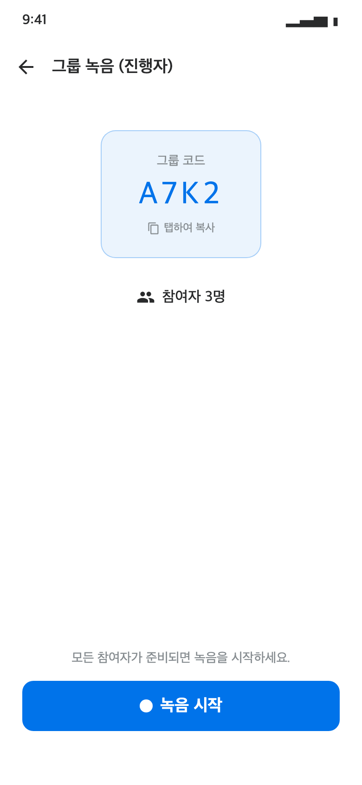
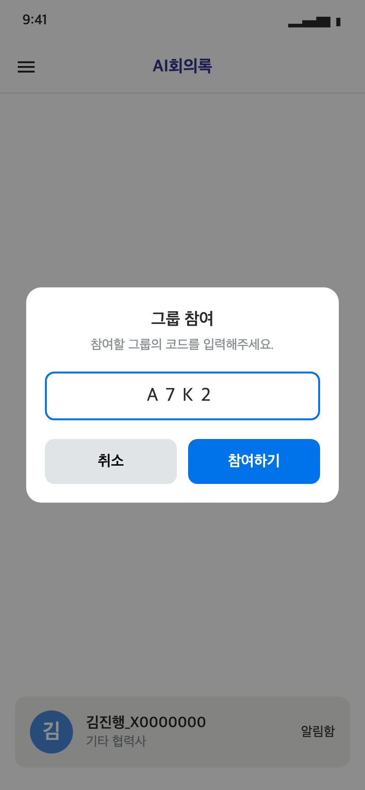
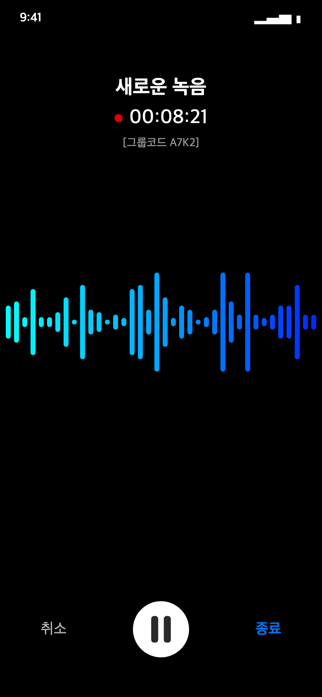
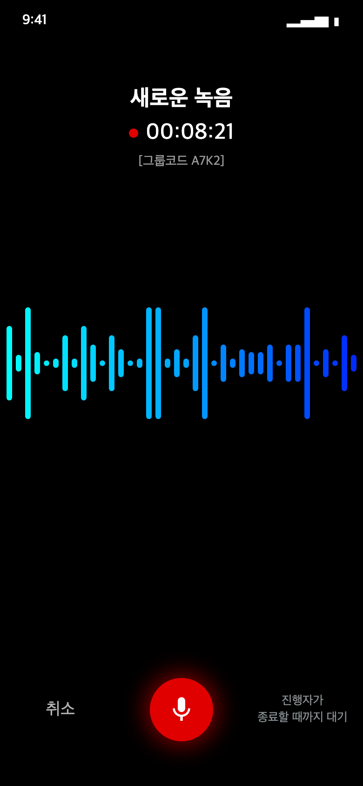

### 3-3. 참여자의 녹음 취소 (그룹 나가기)

참여자가 녹음 중에 **[취소]** 를 누르면 아래 확인 창이 나타납니다.

> **녹음 취소 시 지금까지 녹음된 내용은 반영되지 않으며 그룹 재참여 불가합니다**
>
> [취소진행]  [계속녹음]

- **[취소진행]**: 그룹에서 나가 홈으로 이동합니다. 내 녹음은 회의록에 반영되지 않고, 같은 그룹에 다시 참여할 수 없습니다. 다른 참여자의 녹음은 계속됩니다.
- **[계속녹음]**: 창을 닫고 녹음을 계속합니다.

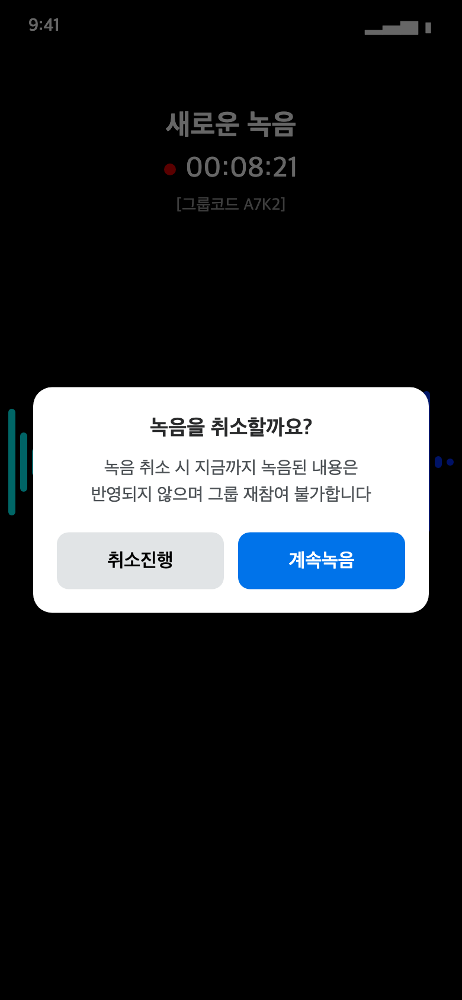

### 3-4. 그룹에 참여할 수 없는 경우

| 안내 메시지 | 원인 |
|---|---|
| 존재하지 않거나 만료된 그룹 코드입니다. | 코드가 틀렸거나, 진행자가 그룹을 나갔습니다. |
| 그룹 정원(최대 5명)이 가득 찼습니다. | 진행자를 포함해 5명이 이미 참여했습니다. |
| 이미 녹음이 시작되어 참여할 수 없습니다. | 녹음이 시작된 뒤에는 중간에 참여할 수 없습니다. |

### 3-5. 신호음 안내

그룹 녹음을 **시작할 때와 끝낼 때 모든 휴대폰에서 안내 음성과 신호음**이 납니다.
서버가 이 소리를 기준으로 여러 기기의 녹음 시점을 정확히 맞추므로, 다음 사항을 꼭 지켜 주세요.

- **휴대폰 음량을 충분히 높여 주세요.** 음량이 너무 낮으면 iPhone에서는 "기기 음량을 높여주세요" 안내가 나타나고, 진행자 휴대폰은 음량을 높일 때까지 녹음을 시작할 수 없습니다. Android는 신호음이 나는 동안 음량이 자동으로 조정됩니다.
- 안내 음성과 신호음은 완성된 회의록에는 포함되지 않습니다.

### 3-6. 녹음 결과 화면 (그룹 녹음의 업로드·변환 진행 확인)

그룹 녹음이 끝나면 진행자와 참여자 **각자의 휴대폰**에 **녹음 결과** 화면이 나타납니다. 업로드는 휴대폰마다 따로 진행되며, 진행 상황도 각자의 화면에서 확인합니다.

- **업로드 진행률**: 참가자 업로드 현황 위에 진행 막대와 %로 전체 업로드 진행률을 표시합니다.
- **참가자 업로드 현황**: 업로드 상태(업로드 완료 / 대기 중 / 실패)를 표시합니다.
- **진행 단계 안내**: 아래 순서로 바뀝니다.
  1. 각자의 녹음이 업로드되면 자동으로 회의록이 만들어집니다.
  2. 녹음을 병합해 회의록을 만들고 있습니다.
  3. 녹음 병합을 마치고 회의록을 만들고 있습니다.
  4. **회의록이 준비되었습니다.**
- 하단 **[홈 화면 이동]** 버튼 위에 회의록이 최종 완료되기 전까지 다음 안내가 **빨간색**으로 표시됩니다.
  > <span style="color:red">확인 시 홈이동, 녹음 파일은 백그라운드로 업로드 됩니다.</span>
- **[홈 화면 이동]** 을 누르면 홈으로 이동합니다. 업로드와 회의록 생성은 백그라운드에서 계속 진행되며, 바로 새 녹음을 시작해도 됩니다.
- **(검토중)** 홈으로 이동한 뒤에도 회의록이 최종 완료될 때까지 **화면 최상단에 진행 상태 바**가 표시됩니다.
- 업로드에 실패하면 홈 하단 패널에 실패 항목이 표시되어 **[재시도] / [삭제]** 를 할 수 있습니다.

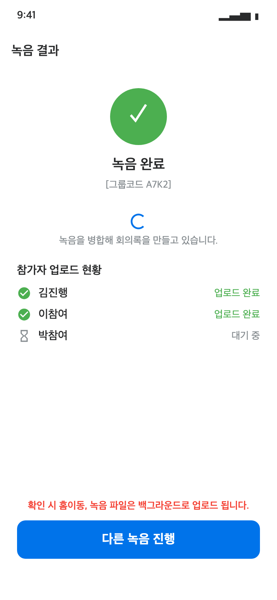

---

## 4. 예외 상황 안내

### 4-1. 녹음 중

| 상황 | 단독 녹음 | 그룹 녹음 |
|---|---|---|
| 전화 수신 ※ 기종에 따라 다를 수 있음 | 자동 일시정지, 통화 후 자동 재개 (재개되지 않으면 녹음 버튼으로 재개) | 녹음이 멈추지 않고 **계속 진행**됨. 통화 중에는 해당 기기만 묵음으로 녹음되고, 회의 녹음은 계속됨 |
| 알림음, 알람, 긴급재난문자 ※ 기종·OS 버전에 따라 다를 수 있음 | 녹음이 잠시 멈출 수 있음. iPhone은 자동 재개, 멈춰 있으면 녹음 버튼으로 재개 | 전화 수신과 같음. 녹음이 멈추지 않고 **계속 진행**되며, 그동안 해당 기기만 묵음으로 녹음됨 |
| 네트워크 끊김 | 영향 없음 (휴대폰에 녹음) | 녹음은 계속됨. 다시 연결되면 진행자의 일시정지/종료 상태를 자동으로 따라감 |
| 최대 녹음 시간 | 3시간 도달 시 자동으로 멈추고 완료 설정 창 표시 | 1시간 |
| 저장공간 95% 초과 | 녹음 자동 중지 | 녹음 자동 중지 |
| 관리자 메일 발송 실패 | "이메일 발송에 실패하였습니다." 안내, **녹음이 시작되지 않음** → 네트워크 확인 후 다시 시도 | 진행자: 단독 녹음과 같음 / 참여자: 안내만 표시되고 녹음은 계속됨 |
| 진행자가 나감 | - | 그룹 녹음 전체 취소, 참여자에게 "방장이 그룹 녹음을 취소했습니다." 안내 |
| 참여자가 [취소] | - | 확인 창에서 [취소진행]을 누르면 본인 녹음은 반영되지 않고 그룹 재참여 불가. 다른 참여자는 계속 녹음 |

### 4-2. 업로드 중

| 상황 | 표시 | 해결 방법 |
|---|---|---|
| 네트워크 연결이 끊김 | "네트워크 연결 대기 중... (연결되면 자동 재개)" | 별도 조치가 필요 없습니다. 연결되면 자동으로 다시 업로드합니다. |
| 업로드 실패 | "업로드에 실패한 파일은 재시도 또는 삭제해 주세요." + **[재시도] / [삭제]** | [재시도]를 누르세요. [삭제]를 누르면 녹음 파일이 삭제되며 복구할 수 없습니다. |
| 업로드 도중 앱이 종료됨 | 앱을 다시 실행하면 홈 패널에 실패 항목으로 표시 | [재시도]를 누르면 업로드가 다시 진행됩니다. |
| 전송하지 못한 녹음을 다시 보내고 싶음 | 메뉴 → **녹음 실패** | 목록에서 **[재전송]** 을 누르세요. 이전에 고른 참석자 수, 언어, 템플릿, 제목이 그대로 채워집니다. |
| 그룹 녹음 업로드 실패 | 홈 하단 패널에 실패 항목 표시 | [재시도]를 누르세요. |
| 녹음 파일 일부가 누락됨 (4-3 참고) | "누락파일이 발생되어 웹에서 재업로드를 시도해주세요, 단 누락된 파일을 제외한 나머지 파일로만 회의록이 완성됩니다" 안내 | PC 웹(AI회의록 시스템)에서 재업로드를 시도하세요. |

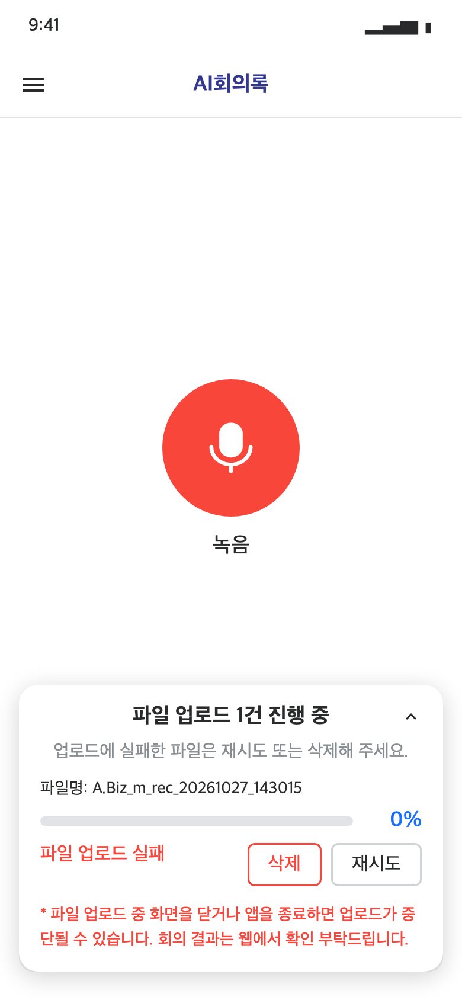


### 4-3. 일부 파일이 누락된 경우

녹음은 **3분 단위 파일**로 나뉘어 서버로 전송됩니다. 이 중 일부 파일이 유실되어 서버에 일부만 올라가면, 서버가 **누락된 파일 목록**을 보내고 실패로 처리합니다.

| 구분 | 업로드 실패 (4-2) | 일부 파일 누락 |
|---|---|---|
| 상태 | 녹음 파일이 모두 휴대폰에 있음 | 녹음 파일 일부가 유실됨 |
| 해결 방법 | 앱 홈 하단 패널에서 [재시도] | PC 웹(AI회의록 시스템)에서 재업로드 시도 |

이 경우 앱에 아래 안내가 나타납니다.

> 누락파일이 발생되어 웹에서 재업로드를 시도해주세요, 단 누락된 파일을 제외한 나머지 파일로만 회의록이 완성됩니다

- PC에서 AI회의록 시스템(https://aimeeting.skhynix.com/)에 접속해 재업로드를 시도해 주세요.
- 누락된 파일을 제외한 나머지 파일로만 회의록이 완성되므로, 누락된 구간의 발언은 회의록에 포함되지 않습니다.

---

## 5. 자주 묻는 질문

**Q. 업로드가 끝날 때까지 기다려야 하나요?**
A. 아니요. 완료 설정에서 [확인]을 누르면 홈으로 이동하고, 바로 다음 녹음을 시작해도 됩니다. 업로드와 변환은 순서대로 자동 진행됩니다. 단, 업로드가 끝날 때까지 **앱을 완전히 종료하지는 마세요.**

**Q. 완성된 회의록은 어디서 보나요?**
A. 회의록이 완성되면 앱 **알림함**에 "회의록이 생성되었습니다." 알림이 옵니다. 회의록 내용은 **PC에서 AI회의록 시스템(https://aimeeting.skhynix.com/)** 에 접속해 확인합니다.

**Q. 녹음을 시작할 때마다 관리자에게 메일이 가나요?**
A. 네. 녹음을 시작할 때 관리자에게 메일이 발송됩니다. 회의 시작 전에 참석자에게 녹음 동의를 받아 주세요. 그룹 녹음은 진행자와 참여자 모두의 기기에서 각각 발송됩니다.

**Q. 녹음 중 전화가 오면 어떻게 되나요?**
A. **단독 녹음**은 자동으로 일시정지되고, 통화가 끝나면 자동으로 다시 녹음됩니다. 기종에 따라 자동으로 재개되지 않으면 녹음 버튼을 눌러 재개해 주세요.
**그룹 녹음**은 멈추지 않고 계속 녹음됩니다. 통화 중에는 해당 기기만 묵음으로 녹음되고, 회의 녹음은 계속 진행됩니다.

**Q. 그룹 녹음에서 참여자가 녹음을 멈추거나 끝낼 수 있나요?**
A. 아니요. 시작, 일시정지, 종료는 진행자만 할 수 있습니다. 참여자는 [취소] → [취소진행]으로 본인만 그룹에서 나갈 수 있습니다. 이 경우 본인의 녹음은 회의록에 반영되지 않고, 같은 그룹에 다시 참여할 수 없습니다.

**Q. 그룹 녹음이 끝난 뒤 결과 화면에서 기다려야 하나요?**
A. 아니요. [홈 화면 이동]을 누르면 홈으로 이동하고, 업로드와 회의록 생성은 백그라운드에서 계속됩니다.

**Q. 그룹 녹음 회의록은 누가 받나요?**
A. 모든 참여자의 음성을 합친 하나의 회의록이 진행자와 참여자 **모두에게** 각자의 회의록으로 생성됩니다. 요약 템플릿과 제목은 진행자가 고른 설정이 똑같이 적용됩니다.

**Q. 녹음이 시작된 그룹에 늦게 참여할 수 있나요?**
A. 아니요. 녹음이 시작된 뒤에는 참여할 수 없습니다.

**Q. 진행자가 실수로 나가면 어떻게 되나요?**
A. 그룹 녹음 전체가 취소되고 모든 참여자의 녹음이 저장되지 않습니다. 진행자는 녹음이 끝날 때까지 화면을 나가지 않도록 주의해 주세요.
