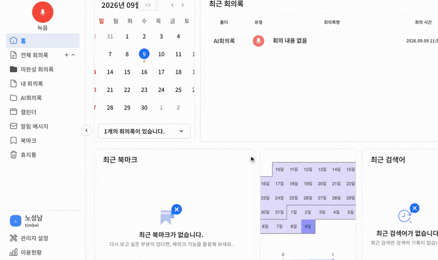
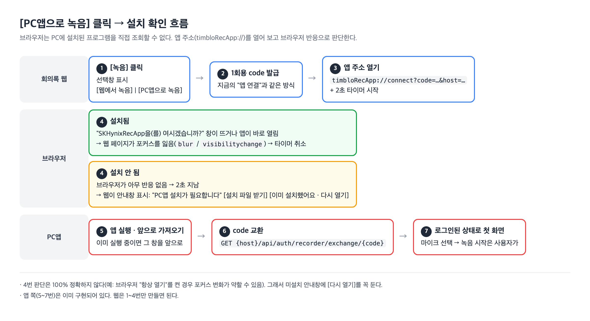

# 회의록 웹 → PC 녹음앱 연동 안내 (웹 개발자용)

> 2026-10-31 작성. 회의록 웹의 [녹음] 버튼에 "PC앱으로 녹음"을 붙일 때 필요한 내용.
> 앱 쪽은 이미 준비되어 있다. **웹에서 만들 것은 아래 1~4번**이다.

## 1. 바뀌는 화면

지금은 왼쪽 위 [녹음]을 누르면 바로 웹 녹음 모달이 뜬다.



앱 배포 후에는 [녹음]을 누르면 먼저 선택창을 띄운다. 문구는 나중에 바뀔 수 있다.

```
┌──────────────── 녹음 방식 선택 ────────────────┐
│   [ 웹에서 녹음 ]        [ PC앱으로 녹음 ]       │
└────────────────────────────────────────────────┘
```

- **웹에서 녹음** → 지금의 웹 녹음 모달 그대로
- **PC앱으로 녹음** → 아래 2~4번

## 2. 흐름



## 3. 앱 설치 여부는 어떻게 아는가

**브라우저는 보안상 PC에 설치된 프로그램을 직접 조회할 수 없다.** (레지스트리·파일 확인 불가)

대신 PC앱을 설치하면 Windows에 앱 주소 **`timbloRecApp://`** 가 등록된다. 웹은 이 주소를 열어 보고 브라우저 반응으로 판단한다.

> 이름 정리: 앱 주소(`timbloRecApp://`)는 내부 이름이라 사용자에게 보이지 않는다. 브라우저 확인창·설치 파일·바로가기 등 **사용자에게 보이는 이름은 `SKHynixRecApp`** 이다. 웹 화면 문구에도 `SKHynixRecApp`(또는 "PC앱")을 쓴다.

| 상황 | 브라우저 반응 | 웹 판단 |
|---|---|---|
| 설치됨 | "SKHynixRecApp을(를) 여시겠습니까?" 확인창이 뜨거나 앱이 바로 열림 → 페이지가 포커스를 잃음 (`blur` / `visibilitychange`) | 열림 (`opened`) |
| 설치 안 됨 | 아무 반응 없음 | 2초 뒤 미설치 (`not-installed`) → 설치 안내창 |

**주의 — 100% 정확하지 않다**
- 사용자가 확인창에서 "항상 열기"를 체크한 경우 등 포커스 변화가 약하게 일어날 수 있다.
- 그래서 미설치 안내창에는 항상 **[설치 파일 받기]** 와 **[이미 설치했어요 · 다시 열기]** 를 같이 둔다.
- 확인창에서 사용자가 [취소]를 눌러도 `opened`로 판단된다. 이 경우 사용자가 다시 누르면 된다.

## 4. 앱 주소 형식

지금 웹의 "앱 연결"에서 쓰는 주소와 **같다.** 새로 만들 API는 없다.

```
timbloRecApp://connect?code={1회용 code}&host={API 서버 주소를 base64로}
```

| 값 | 설명 |
|---|---|
| `code` | 1회용 연결 code. 지금 "앱 연결"에 쓰는 발급 방식 그대로. **한 번 교환하면 다시 못 쓰므로 [다시 열기] 때마다 새로 발급**한다 |
| `host` | 앱이 code를 교환할 API 서버 주소(`https://...`)를 UTF-8 → base64로 바꾼 값 |

앱은 이 주소를 받으면:
1. 앱을 실행한다. 이미 켜져 있으면 그 창을 앞으로 가져온다.
2. `GET {host}/api/auth/recorder/exchange/{code}` 로 토큰을 받는다.
3. 로그인된 상태로 첫 화면(마이크 선택)을 연다. 녹음 시작은 사용자가 누른다.

## 5. 예제 코드

[`openPcApp.js`](openPcApp.js) 참고. 사용 예:

```js
async function onClickPcAppRecord() {
  const code = await issueConnectCode();          // 지금 "앱 연결"에서 쓰는 code 발급 함수
  const result = await openPcApp({ code, apiHost: API_HOST });
  if (result === 'not-installed') {
    showInstallGuide({
      onDownload: () => window.open(INSTALLER_URL), // 아래 '설치 파일 주소' 참고
      onRetry: onClickPcAppRecord,                  // 다시 열기: code 새로 발급
    });
  }
}
```

### 설치 파일 주소 (`INSTALLER_URL`)

PC앱 자동 업데이트에 쓰는 업데이트 서버 폴더(`UPDATE_SERVER_URL`)에 **이름이 고정된 최신 설치 파일**을 같이 올린다.

```
INSTALLER_URL = {UPDATE_SERVER_URL}/SKHynixRecApp-Setup-latest.exe
```

- 배포할 때마다 같은 이름으로 덮어쓰므로 **웹 링크는 바꿀 필요가 없다.**
- 폴더에 있는 `SKHynixRecApp-Setup-0.0.8.exe` 처럼 버전이 붙은 파일은 앱 자동 업데이트용이다. 웹 링크로 쓰지 않는다(배포마다 이름이 바뀜).
- `UPDATE_SERVER_URL` 실제 주소는 회사에서 정해 알려준다.

## 6. 확인 방법

| 확인 | 방법 | 기대 결과 |
|---|---|---|
| 설치된 PC | [PC앱으로 녹음] | 브라우저 확인창 → [열기] → 앱이 로그인된 상태로 뜸 |
| 앱이 이미 켜져 있음 | [PC앱으로 녹음] | 켜져 있던 앱 창이 앞으로 나옴 |
| 설치 안 된 PC | [PC앱으로 녹음] | 약 2초 뒤 설치 안내창 |
| 설치 파일 받기 | 안내창 [설치 파일 받기] | `SKHynixRecApp-Setup-latest.exe` 다운로드 → 실행하면 설치 |
| 주소 등록 확인 (참고) | Windows `Win+R` → `timbloRecApp://` 입력 | 설치된 PC면 앱이 뜸. 레지스트리 `HKEY_CURRENT_USER\Software\Classes\timbloRecApp` 에 등록됨 |

## 7. 참고 — 쓰지 않기로 한 방법

| 방법 | 쓰지 않는 이유 |
|---|---|
| 앱이 PC 안에 작은 웹서버(localhost)를 열고 웹이 물어보기 | 앱이 **꺼져 있으면** 확인이 안 됨. 최신 크롬은 https 사이트 → localhost 요청을 막거나 권한 창을 띄움 |
| 앱이 서버에 "설치함"을 기록하고 웹이 서버에 물어보기 | 서버 작업이 필요하고, 다른 PC에 설치한 경우와 구분이 안 됨 |
